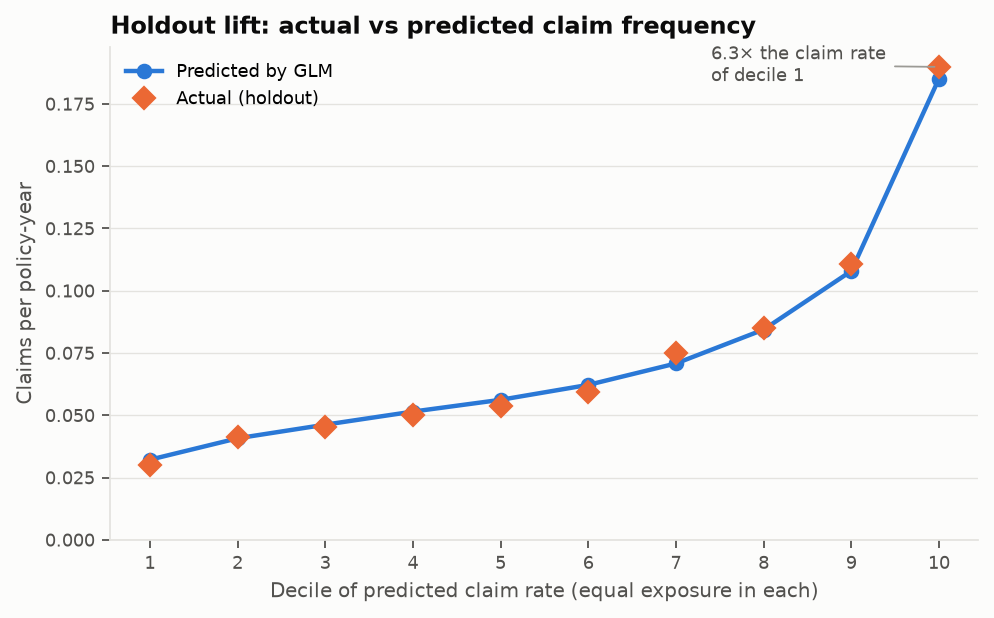
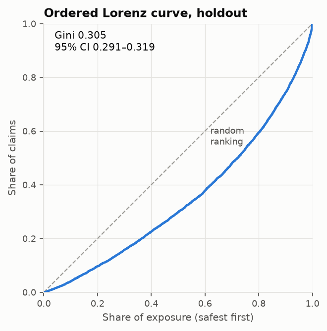

# Motor insurance pricing: a claim-frequency GLM on 678k French policies

[](https://github.com/asht007n/motor-insurance-pricing/actions/workflows/tests.yml)

**Question:** how often will each driver claim, which rating factors drive
that, and does a transparent rating table hold up on policies it has never
seen?

**Answer:** yes. A Poisson GLM, published as a rating table (base rate × one
multiplier per factor), ranks risk well on 136k held-out policies and is
calibrated. The riskiest tenth of the book (by exposure) claims 6.3× as
often as the safest tenth.

**Built with:** Python (statsmodels, pandas), SQL (DuckDB: joins, `UNPIVOT`,
window functions), 25 tests run on every push, and one command that rebuilds
every number below from the raw data.


## Results

| Metric | Fixed holdout | 5-fold grouped CV: mean (range) |
|---|---|---|
| Gini (how well it ranks risk) | 0.305 (95% CI 0.291–0.319) | 0.295 (0.276–0.304) |
| Poisson deviance explained vs a flat rate | 5.2% (95% CI 4.8–5.8%) | 4.9% (4.3–5.1%) |
| Actual / expected claims | 1.004 (5,310 vs 5,288) | 1.000 (0.987–1.018) |
| A/E by decile of predicted rate | 0.93–1.06 | |
| Claim rate, riskiest vs safest decile | 6.3× | |
| Factor levels with \|z\| > 2 on holdout | 2 of 77 (about 3.5 expected by chance) | |

- The fixed holdout was a slightly lucky draw, so the CV mean is the number to quote.
- 5% deviance explained is normal for claim counts: 96% of policies have no
  claim in the year, so most of the variation is luck. A tariff needs ranking
  and calibration, and both hold up.

<p float="left">
  
  
</p>

## What the model found

Relativities are multipliers on the base driver's claim frequency (base =
most common level of each factor: age 40–49, bonus-malus 50).
Full table: [`relativities.csv`](reports/tables/relativities.csv) ·
[chart](reports/figures/relativities.png).

- **Bonus-malus dominates:** 1.62× at 51–59, 4.91× at 100–109, 9.91× at 125+.
  It is France's claims-history score (−5% per claim-free year, floor 50;
  +25% per at-fault claim).
- **Raw one-way tables double count.** 18–20-year-olds claim 3.17× as often
  as 40–49-year-olds in the raw data, but most of that is their bonus-malus
  (new drivers start at 100). With bonus-malus in the model, age adds 1.17×
  (95% CI 1.03–1.34). Same story for Île-de-France: 1.38× raw, 1.03× in the
  model.
- **Car and place:** diesel 1.16×; density 8,000+/km² 1.29× vs 0.79× under
  20/km²; cars 20+ years old 0.62×; brand B12 0.77×.

**Same car, same address, different driver:**

| Driver | Relativities | Expected claims per year |
|---|---|---|
| 45, bonus-malus 50 | base | 0.048 (1 every 21 years) |
| 45, bonus-malus 100 | 4.91 | 0.238 |
| 19, bonus-malus 100 (new driver) | 1.17 × 4.91 | 0.279 |

The 19-year-old is expected to claim only 17% more often than the
45-year-old at the same bonus-malus, because a 45-year-old at 100 has usually had recent claims while
a 19-year-old has just started. That same effect makes the age curve dip
below 1.00 for ages 21–39 (0.58 at 26–29). An age × bonus-malus interaction
is the first fix on the [roadmap](docs/roadmap.md).

Price any driver from the published table:

```
python -m mtpl.rating --age 22 --bonus-malus 90 --vehicle-age 4 --power 6 \
    --brand B12 --fuel Diesel --density 2500 --region Ile-de-France
```

## Data

[freMTPL2](https://github.com/dutangc/CASdatasets) (CASdatasets R package):
French motor third-party liability policies, mostly one year of cover around
2011–2013. One table has a row per policy, the other a row per claim with its
amount. The download is pinned to one commit and checked against a SHA-256
hash; raw data is never committed.

| | Policies | Claims | Policy-years |
|---|---|---|---|
| Raw | 677,991 | 26,444 | 358,483 |
| After cleaning | 677,991 | 26,405 | 358,343 |
| Training (80%) | 542,055 | 21,095 | 286,602 |
| Holdout (20%) | 135,936 | 5,310 | 71,741 |

**Problems found and how they were handled:**

| Problem | Fix |
|---|---|
| Claim counts must match the claim records (needed for severity later) | Reconciled in SQL; all policies match in this version (about 9,000 reportedly don't in older public copies) |
| Policy ID stored by R as `1e+05` | Parsed as a number, checked no IDs were lost |
| 8 policies with 5–16 claims, 7 of them near-identical (likely one fleet or duplicates) | Claim count capped at 4 (removes 39 claims) |
| 1,224 policies with over a year of exposure (up to 2.01) | Exposure capped at 1 |
| 38% of policies share all nine rating fields, most look like one driver split across records | Train/holdout split keeps identical profiles together |

Details: [`docs/data_notes.md`](docs/data_notes.md).

## Method

| Step | Choice | Why |
|---|---|---|
| Data layer | DuckDB SQL | Reconciliation, cleaning log, factor and lift summaries |
| Rating factors | Age, bonus-malus, vehicle age, power and density in bands; brand, fuel, region as given; Area dropped | Bands give one readable relativity each; Area duplicates density (correlation 0.97) |
| Model | Poisson GLM, log link, log(exposure) offset | Counts per policy-year; log link makes it multiplicative, i.e. a rating table |
| Fitting | On 193,242 rating cells instead of 542k policies | Same coefficients as a policy-level fit (unit-tested) on a third of the rows |
| Overdispersion | Pearson φ 1.72 (fragile), standard errors scaled by √φ | Negative binomial refit moves no relativity by more than 1.1% |
| Validation | Grouped holdout, 5-fold grouped CV, bootstrap CIs, A/E by decile and factor level | Honest error bars, and a fair baseline for a later ML challenger |

Every choice, the alternatives and the evidence are in
[`docs/modeling_decisions.md`](docs/modeling_decisions.md).

## Limitations

- **No dates**, so no out-of-time test; a same-period holdout is optimistic about drift.
- **No interactions** yet: the age × bonus-malus effect above is only approximated.
- **Bonus-malus timing is undocumented.** If it was recorded at year end, it
  partly reflects the claims being predicted and its relativities are overstated.
- **Frequency only**, so no price in euros until the severity model.
- **Small regions are not credibility-weighted** (Franche-Comté: 453
  policy-years, CI 0.63–1.58).
- **The caps follow convention** (same as the
  [scikit-learn freMTPL2 example](https://scikit-learn.org/stable/auto_examples/linear_model/plot_tweedie_regression_insurance_claims.html));
  their effect is untested.
- One insurer, one country, one period.

## How to run

Python 3.10+, about 3.2 GB of free RAM (1.5 GB with `--no-nb`, which skips the
negative binomial check). The first run downloads about 10 MB.

```bash
git clone https://github.com/asht007n/motor-insurance-pricing.git
cd motor-insurance-pricing
python -m venv .venv
source .venv/bin/activate        # Windows: .venv\Scripts\activate
pip install -e ".[dev]"

python -m mtpl.pipeline          # data -> model -> reports/ (about 1-2 minutes)
pytest -q                        # 25 tests on simulated data, no download needed
```

Every number above is written to [`reports/metrics.json`](reports/metrics.json)
and [`reports/tables/`](reports/tables/). The DuckDB database is saved to
`data/mtpl.duckdb` for querying.

## Repository layout

```
sql/            reconciliation, cleaning, factor summary (UNPIVOT), lift (window functions), data profile
src/mtpl/       data download, features, GLM, metrics, rating calculator, plots, pipeline
tests/          25 tests on simulated data
reports/        figures, tables and metrics.json (committed)
docs/           modeling decisions, data notes, roadmap
```

## Next

Severity model, pure premium, a LightGBM challenger judged on the same folds,
and a deployed rating calculator. See the [roadmap](docs/roadmap.md).

## Data licence and credit

freMTPL2 is distributed in CASdatasets by C. Dutang and A. Charpentier
(GPL ≥ 2). This repo downloads it at run time and does not redistribute it.
Code is MIT licensed.
