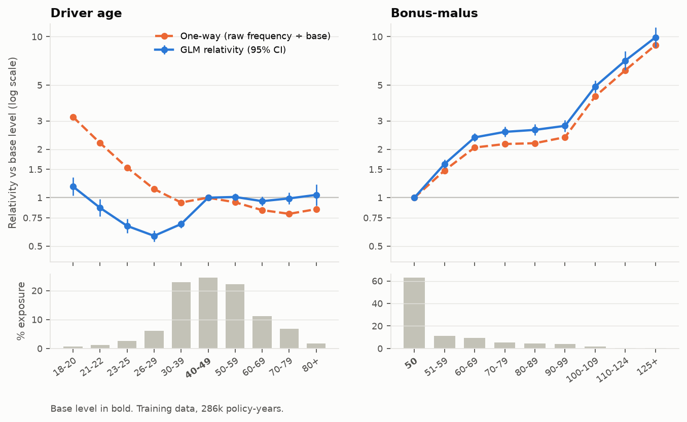

# Motor insurance pricing: a claim-frequency GLM on 678k French policies

How often will each driver claim, which rating factors drive that, and does a
transparent rating table hold up on policies it has never seen?

This repo builds the claim-frequency half of a motor liability tariff in
Python: a Poisson GLM with an exposure offset, published as a rating table
(base rate × one multiplier per factor), with the data layer in SQL and every
number reproducible from one command.

**Answer:** yes. On a holdout of 136k policies the table ranks risk well
(Gini 0.305; 0.295 averaged over five cross-validation folds) and is
calibrated (5,310 actual claims vs 5,288 predicted, A/E 1.004). The riskiest
tenth of exposure claims 6.3 times as often as the safest tenth. Two findings matter more than the headline metrics: using raw
one-way frequencies as the age factor would charge 18–20-year-olds about 2.7×
what age actually adds once bonus-malus is counted, and the model's age curve
exposes an age × bonus-malus interaction that is the first thing to fix next.



## Results

| Metric | Fixed holdout (136k policies, 71.7k policy-years) | 5-fold grouped CV: mean (range) |
|---|---|---|
| Gini (ordered Lorenz, exposure-weighted) | 0.305 (95% CI 0.291–0.319) | 0.295 (0.276–0.304) |
| Poisson deviance explained vs flat rate | 5.2% (95% CI 4.8–5.8%) | 4.9% (4.3–5.1%) |
| Actual / expected claims | 1.004 | 1.000 (0.987–1.018) |
| A/E by decile of predicted rate | 0.93–1.06 | |
| Claim rate, riskiest vs safest decile | 6.3× | |
| Share of claims from riskiest 10% of exposure | 25.6% | |
| Factor levels with \|z\| > 2 on holdout | 2 of 77 (about 3.5 expected by chance) | |

The fixed holdout turned out to be a slightly favourable draw, so the
cross-validation mean is the better estimate of performance on new policies.

A deviance explained of 5% looks small but is normal for claim counts: 96% of
policies have no claim in the year, so most of the variation is luck no model
can predict. What a tariff needs is ranking (Gini, lift) and calibration
(A/E), and both hold up.

<p float="left">
  
  
</p>

### What the rating table says

All relativities are claim-frequency multipliers against the base driver
(age 40–49, bonus-malus 50, the most common level of every factor). Full
table with confidence intervals: [`reports/tables/relativities.csv`](reports/tables/relativities.csv)
and [`reports/figures/relativities.png`](reports/figures/relativities.png).

- **Bonus-malus is by far the strongest factor**: 1.62× at 51–59, 4.91× at
  100–109 and 9.91× at 125+. It is the French claims-history coefficient
  (it falls 5% each claim-free year to a floor of 50 and rises 25% per
  at-fault claim), so it carries most of what the insurer knows about the
  driver's past.
- **One-way analysis double counts.** Drivers aged 18–20 claim 3.17× as often
  as the base in the raw data, but most of that is their bonus-malus: new
  drivers start at 100 and have not had time to earn a bonus. With
  bonus-malus in the model, age alone adds 1.17× (95% CI 1.03–1.34). The
  same thing happens to Île-de-France: 1.38× raw, 1.03× once population
  density and the other factors are in the model.
- **Car and place:** diesel 1.16×, density 8,000+/km² 1.29× vs 0.79× under
  20/km², vehicles 20+ years old 0.62×, brand B12 0.77×.

### Worked example: same car, same address, different driver

| Driver | Relativities applied | Expected claims per year |
|---|---|---|
| 45, bonus-malus 50 | base | 0.048 (1 claim every 21 years) |
| 45, bonus-malus 100 | bonus-malus 4.91 | 0.238 |
| 19, bonus-malus 100 (new driver) | age 1.17 × bonus-malus 4.91 | 0.279 |

The model prices the 19-year-old only 17% above the 45-year-old with the same
bonus-malus. That is not a bug: a 45-year-old at 100 has had recent at-fault
claims, while a 19-year-old at 100 has simply just started. It is also why
the age curve dips below 1.00 for drivers aged 21–39: at a given bonus-malus,
younger drivers have had less time to earn their bonus, so their coefficient
overstates their risk and the age factor corrects for it. A purely
multiplicative model can only make that correction through age, which is
what an age × bonus-malus interaction would fix (see [roadmap](docs/roadmap.md)).

Try any driver with the rating calculator, which uses only the published table:

```
python -m mtpl.rating --age 22 --bonus-malus 90 --vehicle-age 4 --power 6 \
    --brand B12 --fuel Diesel --density 2500 --region Ile-de-France
```

## Data

[freMTPL2](https://github.com/dutangc/CASdatasets) from the CASdatasets R
package: motor third-party liability policies from an unnamed French insurer,
observed mostly over one year around 2011–2013. Two tables:
`freMTPL2freq` (one row per policy: exposure, claim count, nine rating
fields) and `freMTPL2sev` (one row per claim with its amount).

The download is pinned to one commit of the source repository and checked
against a SHA-256 hash, so the numbers here can be reproduced exactly. Raw
data is never committed. Details: [`docs/data_notes.md`](docs/data_notes.md).

| | Policies | Claims | Policy-years |
|---|---|---|---|
| Raw | 677,991 | 26,444 | 358,483 |
| Claim counts reconciled to severity table | 0 changed | 26,444 | |
| Claim count capped at 4 | 8 changed | 26,405 | |
| Exposure capped at 1 year | 1,224 changed | | 358,343 |
| Training set (80%) | 542,055 | 21,095 | 286,602 |
| Holdout (20%) | 135,936 | 5,310 | 71,741 |

**Reconciliation.** Every claim priced needs both a count and an amount, so
the first SQL step checks that the claim count on each policy matches its
claim records. In this pinned version all 677,991 policies match. Older public
copies of freMTPL2 (OpenML, Kaggle, Hugging Face) are a different version
with 678,013 policies and 26,639 claim records, where about 9,000 policies
reportedly disagree. The reconciliation SQL handles either and is tested on a
toy database with every kind of mismatch.

**Data problems found and handled:**
- One policy ID was stored by R as `1e+05`. Casting the text to an integer
  fails; the loader parses it as a number and checks no IDs were lost.
- Eight policies have 5–16 claims. Seven share a near-identical profile
  (driver aged 52–53, bonus-malus 50, brand B1, Languedoc-Roussillon) with
  exposures of 0.07–0.41 years: almost certainly one fleet or duplicated
  records. Capped at 4.
- 1,224 policies have exposure above one year (up to 2.01) in data described
  as one-year. Capped at 1.
- 257,908 policies (38%) share all nine rating fields with at least one
  other policy. In 79% of these groups the policy IDs sit within 100 of each
  other (median gap 2), and their policies average 0.33 years of exposure
  against 0.53 overall: most look like one driver's year split across
  several records. The train/holdout split keeps identical profiles together
  so the same driver cannot appear on both sides.

## Method

Each choice, the alternatives and the evidence for it are written up in
[`docs/modeling_decisions.md`](docs/modeling_decisions.md). In short:

1. **SQL data layer (DuckDB).** Load, reconcile frequency against severity
   with joins, log every cleaning rule with its row count, then build the
   per-factor and lift summaries with `UNPIVOT` and window functions
   ([`sql/`](sql/)).
2. **Rating factors.** Driver age, bonus-malus, vehicle age, power and
   density are banded so each band has enough exposure for a stable
   relativity; brand, fuel and region are used as given. Area is left out
   because it is a coarse banding of density (correlation 0.97 with log
   density).
3. **Poisson GLM, log link, log(exposure) offset.** The offset makes the
   model estimate claims per policy-year, so a policy insured for three
   months is expected to have a quarter of a full year's claims. The log link
   makes the coefficients multiplicative, which is what a rating table is.
4. **Fit on rating cells.** Policies with identical rating factors are pooled
   (193,242 cells). For a Poisson model this gives exactly the same
   coefficients as fitting 542k policies, which a unit test checks.
5. **Overdispersion.** Pearson dispersion is 1.72 but fragile: the 100
   most extreme of 542k policies supply 22% of it, and it drops to 1.33
   without the 33,830 policies insured for under 0.05 years (about 18 days). The
   Cameron–Trivedi test is not significant (t = 1.62). Standard errors are
   scaled up by √1.72 anyway (quasi-Poisson), and a negative binomial refit
   moves no relativity by more than 1.1% and gives the same holdout deviance.
6. **Validation.** Holdout grouped by risk profile; Poisson deviance, Gini,
   lift and A/E by decile and by factor level; bootstrap intervals; 5-fold
   grouped cross-validation for the split-to-split range.

## Limitations

- **No dates, so no out-of-time test.** A real tariff is validated on a later
  policy year. A random holdout from the same period is optimistic about
  drift.
- **No interactions.** The age × bonus-malus effect above is real and the
  additive model can only approximate it.
- **When bonus-malus was recorded is not documented.** If it was taken at the
  end of the policy year, it partly reflects the claims being predicted and
  its relativities are overstated. The data cannot settle this, so it is
  flagged rather than assumed away.
- **Frequency only.** Without the severity model there is no price in euros
  yet.
- **Small regions are not credibility-weighted.** Franche-Comté has 453
  policy-years and a CI of 0.63–1.58. A production tariff would merge or
  shrink such cells.
- **The duplicate-driver grouping is a proxy.** Unrelated drivers who happen
  to match on all nine fields are grouped together (harmless), and true
  duplicates that differ on one field are not (they can still leak).
- **The caps follow convention** (the same caps as the
  [scikit-learn freMTPL2 example](https://scikit-learn.org/stable/auto_examples/linear_model/plot_tweedie_regression_insurance_claims.html));
  their effect on the relativities has not been tested separately.
- One insurer, one country, one period: the relativities describe this
  portfolio, not motor risk in general.

## How to run

Needs Python 3.10+ and about 1.5 GB of free RAM (3.2 GB with the negative
binomial check). The first run downloads about 10 MB.

```bash
git clone https://github.com/<your-username>/motor-insurance-pricing.git
cd motor-insurance-pricing
python -m venv .venv
source .venv/bin/activate        # Windows: .venv\Scripts\activate
pip install -e ".[dev]"

python -m mtpl.pipeline          # data -> model -> reports/ (about 1-2 minutes)
python -m mtpl.pipeline --no-nb  # same, skipping the negative binomial check
pytest -q                        # 25 tests on simulated data, no download needed
```

Everything the README quotes is written by the pipeline to
[`reports/metrics.json`](reports/metrics.json) and
[`reports/tables/`](reports/tables/). The DuckDB database lands in
`data/mtpl.duckdb` if you want to query it directly.

## Repository layout

```
├── sql/
│   ├── 01_reconcile.sql        claim counts vs claim records, orphans
│   ├── 02_clean.sql            cleaning rules + cleaning_log
│   ├── 03_factor_summary.sql   exposure, claims, A/E per factor level (UNPIVOT)
│   ├── 04_lift.sql             equal-exposure deciles (window functions)
│   └── 05_data_profile.sql     data facts quoted in the docs
├── src/mtpl/
│   ├── config.py               data pin, thresholds, bands
│   ├── data.py                 download, checksum, .rda -> parquet -> DuckDB
│   ├── features.py             banding, grouped split, base levels
│   ├── frequency.py            Poisson GLM, dispersion checks, rating table
│   ├── evaluate.py             deviance, Gini, bootstrap intervals
│   ├── rating.py               price any driver from the published table
│   ├── plots.py                README figures
│   └── pipeline.py             end-to-end run
├── tests/                      25 tests on simulated data
├── reports/                    figures, tables, metrics.json (committed)
└── docs/
    ├── modeling_decisions.md   every choice and why
    ├── data_notes.md           source, dictionary, data quirks
    └── roadmap.md              severity, pure premium, GBM challenger, app
```

## Next

Severity model, pure premium, a LightGBM challenger judged on the same
folds, and a deployed rating calculator. See [`docs/roadmap.md`](docs/roadmap.md).

## Data licence and credit

freMTPL2 is distributed in CASdatasets by C. Dutang and A. Charpentier
(GPL ≥ 2). This repo downloads it at run time and does not redistribute it.
Code is MIT licensed.
